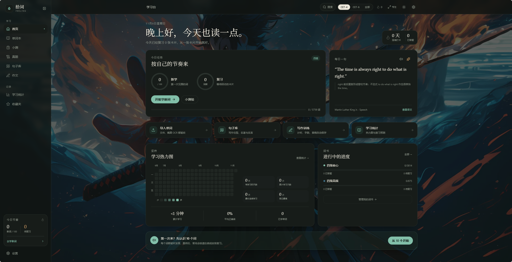
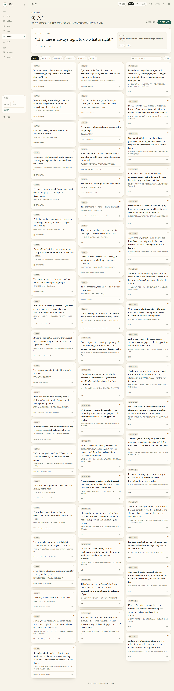
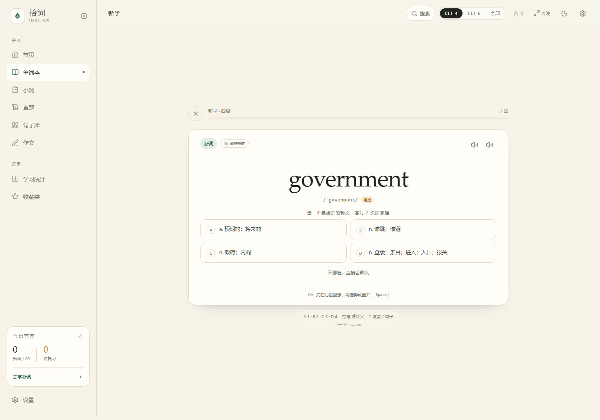
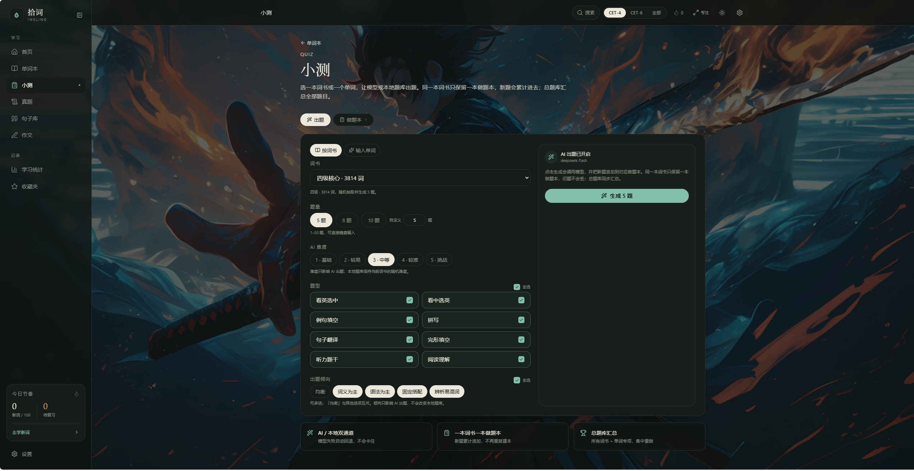
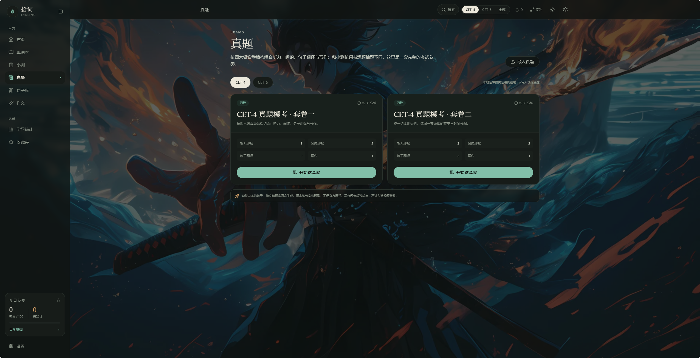
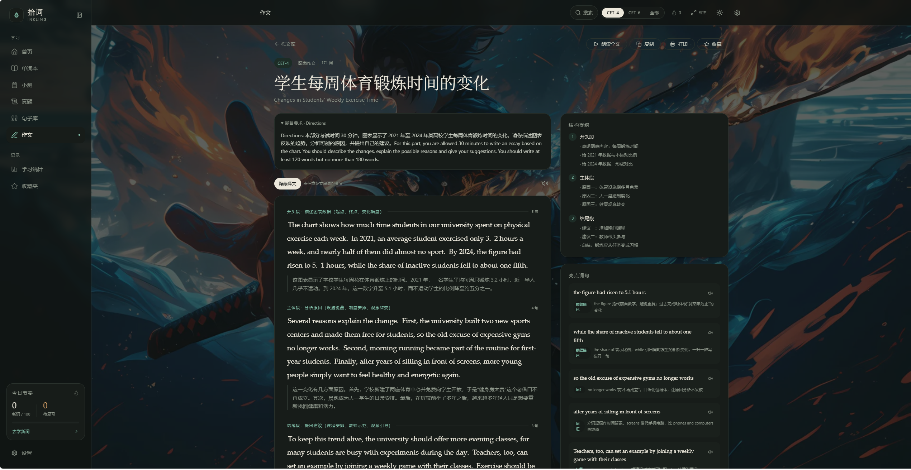

# VerbaGather-share（拾词）

> 一座安静的本机自习室：英语四六级 **单词 / 句子 / 作文 / 小测 / 真题**，可朗读、可对照翻译、可点词查询，断网也能用。



| 单词本 | 句子库 |
| --- | --- |
|  |  |

| 新学 · 先测后学 | 小测 · AI 出题 |
| --- | --- |
|  |  |

| 真题 · 套卷模考 | 作文 · 逐段精读 |
| --- | --- |
|  |  |

> 截图来自全新演示数据库，不包含个人学习数据。更多界面见 [`docs/screenshots`](docs/screenshots)。

## 快速开始

需要 **Node.js 22.13+**（使用内置 `node:sqlite`）。

```bash
npm install
npm run build
npm start
```

打开 <http://127.0.0.1:5178>。如果端口被占用，服务会自动顺延，以终端打印的地址为准。

也可以直接双击 **`start.bat`**，或运行 `start.ps1`：脚本会自动检查 Node、安装依赖、构建并打开浏览器。

开发模式：

```bash
npm run dev
# 前端 http://127.0.0.1:5173
# API  http://127.0.0.1:5178
```

> 如果 `npm install` 因环境限制在安装脚本处失败，可改用 `npm install --ignore-scripts`；Vite 的 esbuild 与 Tailwind 二进制包通常仍可正常工作。

## 功能

### 单词

- 预置 **四级核心 3,814 词**、**六级新增 1,945 词**，另设 **四级高频 875 词**，合计 **5,759 词**。
- 每个词条含音标、中文释义、英英释义、词形变化、柯林斯/牛津星级与词频。
- **多本词书**：系统词书之外可创建自定义词书，支持改名、换色、删除；可指定默认生词本。
- **单词收藏**：词书列表和单词详情均可星标，收藏夹集中查看，不改变学习进度。
- **新学（先测后学）**：先看单词和例句挖空，从 4 个释义中选择；累计 2 次答对自动标为掌握，答错会进入后续复习。
- **经典闪卡**：可一键切换翻转模式，正面看词，翻面看释义、例句和词形。
- **每日新词**：最高 200 个/天，队列按设置取词。
- **复习**：到期队列，五种题型轮换；调度由 SM-2 变体计算，支持连对、斩词和自评。
- **测验**：按词书或单词出题，即时判分，错词自动进入错题本。
- 400 个核心词配有中英精讲例句，其余词也能查看英英释义和词形。
- 导入：**PDF / Word / CSV / TSV / TXT / MD / JSON / 图片 OCR**，本地解析、词典补全、预览可编辑、按词书去重。
- 支持下载 CSV 模板后批量导入。

### 句子（100 条 + 自定义）

- 写作句型 40 条、励志名言 20 条、公版名著摘抄 25 条、四六级高频表达 15 条。
- 按类型、级别、收藏、关键词筛选；详情含人工译文、亮点讲解、出处/作者、难度。
- **自定义导入**：支持 PDF / Word / CSV / TXT / MD / JSON / 图片 OCR / 粘贴。
- 一行英文一行中文会自动配对；纯英文按标点拆句；导入前可逐条修改英文与译文。
- 导入后归入「我的句子」，可继续编辑、删除，也会参与全局搜索和收藏。
- 每日一句按日期轮换；整句朗读；复制；点任意英文单词查义、发音、收进生词本。

### 作文（16 篇 + 40 模板）

- 四级 8 篇、六级 8 篇，覆盖议论文、图表、书信、通知、演讲、评论，按考试字数区间撰写。
- 每篇含中英题目与要求、分段范文、逐段译文、结构提纲、亮点词句、评分要点和字数。
- 阅读模式支持对照译文、整篇朗读、复制、打印/另存 PDF。
- 句型模板库：40 条万能句，按类型和用途筛选，可复制、朗读。
- **写作训练**：选题 → 计时 + 实时字数 + 行距稿纸 → 自动保存草稿 → 完成后的自检清单。
- **作文草稿**保存在 SQLite，不再依赖浏览器 `localStorage`；刷新、重开浏览器后可继续写。
- **导入作文**：粘贴 JSON，或选择 JSON / TXT / Markdown / PDF / Word 文件；解析后先预览，再写入本机 SQLite。
- **AI 作文评分**：写作训练可调用独立模型给出 15 分制参考分、分项评价、优点、改进和可替换表达；不是官方成绩。

### 小测 · AI 出题 · 做题本

- **两种出题来源**：选一本词书，或直接输入一个单词（自动从本地词典补全音标和释义）。
- **两种出题通道**：开启 AI 后调用 OpenAI 兼容模型实时出题；未开启或失败时自动回退本地题库，离线可用。
- 本地题型：看英选中、看中选英、例句填空、拼写。
- AI 另支持：句子翻译、完形填空、听力题干、阅读理解。
- 题量支持 5 / 8 / 10 和自定义 1–50 题，可直接键盘输入。
- AI 难度支持 **1–5 级**；出题倾向支持词义为主、语法为主、固定搭配、辨析易混词、均衡，其中「均衡」与其他选项互斥。
- 题型和倾向都有「全选」勾选框：默认全选，点击取消全部，再点恢复。
- 选项顺序随机，不固定把答案放在 A。
- 做题时可朗读单词或例句；答对/答错有不同提示音，小测提示音可单独开关。
- **必须作答才能进入下一题**：未提交时没有「下一题」，回车也不会跳过。
- **做题本**：同一本词书只保留一本做题本，新题累计追加；记录做过次数、上次成绩、最好成绩。
- **总题库**：汇总所有词书做题本与单词专项题目，可整本重做。
- **按题型重做**：重做前可多选、全选本轮要练的题型，不会修改原做题本。

### 真题 · 套卷节奏

- 按四六级套卷结构组合听力、阅读、句子翻译和写作。
- 支持 CET-4 / CET-6，显示套卷结构、预计时长和写作题。
- 选择题做完后显示正确率，写作题单独展开。
- 套卷由本地句子、作文和题库组合生成，用于练题型和节奏，**不是官方原卷**，不会写入学习进度。
- **导入真题**：粘贴或选择 JSON，解析后先预览，再写入本机 SQLite；导入套卷可开始、删除。
- 真题数据保存在服务端数据库，不使用浏览器持久化存储。

### AI 翻译 · 选中即译 · 追问对话

- 任意页面选中一个单词或一句话，会出现「AI 翻译」按钮；点开先看原文和译文。
- 译文可复制；点「继续追问」后进入右侧独立栏，保留上下文。
- 可以问词性、语法、搭配、语气、为什么这样翻译等。
- 翻译与追问使用独立模型配置，和 AI 出题、AI 搜索、作文评分完全分开。
- 关闭右侧栏后仍保留对话，可通过右下角「AI 对话」重新打开。

### AI 搜索 · 本地 / 模型双模式

- 搜索框可切换「本地搜索」和「AI 搜索」。
- 本地模式离线可查单词、句子、作文和模板。
- AI 模式会把本地相关结果作为上下文，请模型回答单词、语法、搭配或写作问题，不写入学习进度。
- 搜索使用独立模型配置，设置在「设置 → AI 搜索」。

### 全局

- 首页学习台：今日任务双进度环、每日一句、热力图、词书进度、连续打卡。
- 学习统计：正确率、累计时长、近 140 天热力图、未来 7 天复习预测、30 天节奏、各词书进度。
- 全局搜索（默认 `Ctrl+K`）、收藏夹、深浅色主题、移动端底部导航。
- 侧栏可收起为图标栏，收起状态会记住。
- 设置 → 外观：可上传本机图片作为全站背景，并调整不透明度。
- **专注模式**：隐藏侧栏、顶栏、底部导航、搜索和 AI 面板，保留中间卡片与自定义背景；`Esc` 或快捷键退出。
- 数据落盘本机 SQLite，一键备份/恢复。
- 支持自定义快捷键、朗读音色/语速、自动朗读和提示音。

## 内容规模

| 内容 | 数量 | 来源 |
|---|---:|---|
| 四级核心词 | 3,814 | ECDICT（MIT）`cet4` 标签 |
| 四级高频词 | 875 | 四级核心中柯林斯 4 星及以上的词 |
| 六级新增词 | 1,945 | ECDICT `cet6` 且非 `cet4` |
| 本地词典 | 45,032 | ECDICT 常用词裁剪，供点词查询/导入补全 |
| 精讲例句 | 400 | 本项目撰写 |
| 种子句子 | 100 | 本项目撰写；名著为公版引文 |
| 作文 | 16 | 本项目撰写 |
| 作文模板 | 40 | 本项目撰写 |
| 自定义句子 / 真题 / 作文 / 做题本 | 不限 | 用户导入与生成 |

## 导入说明

### 单词

| 来源 | 支持 | 说明 |
|---|---|---|
| 文件 | `.pdf` `.docx` `.csv` `.tsv` `.txt` `.md` `.json` | 浏览器本地解析，不上传服务器 |
| 图片 | `.png` `.jpg` `.webp` | 本地 tesseract.js OCR，英文语言包约 3 MB |
| 粘贴 | 任意文本 | 每行一个词，支持 `word 释义`、`word - 释义`、`word,释义` |
| 手动 | 表单 | 留空释义会自动查本地词典 |

- 支持编号、`word | 释义`、Tab/逗号分隔、CSV 表头。
- 导入前展示预览：单词、音标、释义、是否已存在；可编辑、勾选、删除。
- 已存在的词不覆盖学习进度，只补进目标词书。
- 扫描版 PDF 没有文本层时，请截图后用「图片识别」。
- OCR 对拍照、低分辨率、手写体准确率有限，结果必须人工核对。

### 句子

| 来源 | 说明 |
|---|---|
| PDF / Word / TXT / MD | 一行英文一行中文自动配对；纯英文按标点拆句 |
| CSV / JSON | 识别 `en` / `text_en` / `sentence` 与 `cn` / `translation` / `text_cn` 列 |
| 图片 | 本地英文 OCR，只识别英文，译文留空后手补 |
| 粘贴 | 支持 `英文\t中文`、`英文 ｜ 中文`、`英文 — 中文`，或英文/中文交替行 |

- 导入前逐条预览，可修改英文与译文、勾选、删除。
- 导入后归入「我的句子」，可继续编辑、删除，也参与全局搜索与收藏。

### 作文

- 支持 JSON 数组、JSON 单篇、TXT、Markdown、PDF、Word。
- 纯文本格式约定：标题为第一行，空行分段，多篇用 `---` 分隔。
- 解析后先预览，确认后写入 SQLite；自定义作文可删除。
- 旧版本浏览器中的 `inkling-draft-*` 作文草稿会自动迁移到数据库。

## 发音说明

朗读使用浏览器 **Web Speech API**，不调用在线音频：

- Edge（Windows）通常提供 Microsoft Aria / Guy / Libby 等音色，效果最好；
- Chrome / Safari 使用系统英文语音；
- 可在「设置 → 朗读」切换美式/英式、调整语速、试听；
- 若系统没有英文语音，浏览器会静默或使用默认音色，建议使用 Edge。

## 快捷键

默认快捷键如下，可在「设置 → 快捷键」点击按键后重新录制：

| 键 | 作用 |
|---|---|
| `Ctrl+K` / `⌘K` | 打开全局搜索 |
| `F` | 进入 / 退出专注模式 |
| `1–4` | 新学：选择释义；复习/小测：选择答案 |
| `Space` | 新学/闪卡：显示答案或翻面 |
| `Enter` | 拼写提交；新学与闪卡显示答案/下一题；小测提交后才进入下一题 |
| `P` | 再读一次：单词题读单词，例句填空读整句 |
| `Esc` | 关闭弹窗、搜索、词卡；退出专注模式 |

## AI 配置

四种 AI 能力分别配置，互不影响：

| 能力 | 设置位置 | 用途 |
|---|---|---|
| AI 出题 | 设置 → AI 出题 | 生成小测题、难度和出题倾向 |
| AI 翻译 | 设置 → AI 翻译 | 选中即译、右侧追问 |
| AI 搜索 | 设置 → AI 搜索 | 搜索框 AI 模式 |
| AI 作文评分 | 设置 → AI 作文评分 | 写作训练参考分与分项评价 |

每项需要填写：

- **Base URL**：OpenAI 兼容地址，例如 `https://api.deepseek.com/v1`
- **模型**：例如 `deepseek-chat`
- **API Key**：只保存在本机数据库，不会发送到该 Base URL 之外的地方

调用失败、超时或返回格式不合法时会自动回退本地逻辑；本地出题不消耗 token。

## 数据与备份

- 数据库：`data/app.db`（SQLite，首次启动自动建表并导入种子内容）。
- 所有业务数据、导入真题/作文、作文草稿、做题本、收藏和设置都写入这里。
- 备份：设置 → 数据 → 导出 JSON；包含词书、单词、进度、自定义句子、真题、作文、作文草稿、做题本、收藏与设置。
- 重置：设置 → 重置学习进度（保留词书），或删除 `data/app.db` 后重启恢复初始状态。
- 所有数据默认只在本机；接口默认监听 `127.0.0.1`。设置 `HOST=0.0.0.0` 可让同 Wi-Fi 设备访问（无鉴权，仅建议家庭网络）。
- 浏览器只保留少量界面偏好（侧边栏折叠、新学测义/翻转模式）；业务数据和写作草稿都在 SQLite。

`data/` 已在 `.gitignore` 中整体排除，不会上传个人数据库、WAL/SHM 或 API Key。

## 目录结构

```text
VerbaGather-share/
├─ src/                  # React 前端
│  ├─ pages/             # 首页、单词、句子、作文、小测、真题、统计、设置…
│  ├─ components/        # 布局、题目、导入、热力图、点词查询、AI 面板…
│  ├─ lib/               # API、TTS、导入、OCR、Draft 迁移、工具
│  └─ styles/
├─ server/
│  ├─ index.mjs          # Express + 静态托管 + SPA 回退
│  ├─ db.mjs             # 建表、迁移、SQLite 配置
│  ├─ seed.mjs           # 种子数据导入
│  ├─ lib/               # SRS、本地出题、AI 客户端
│  ├─ routes/            # books / words / study / content / stats / settings / quizsets / papers / essayDrafts
│  └─ seed/              # 词库、词典、句子、作文、模板、例句
├─ shared/types.ts       # 前后端共享类型
├─ scripts/              # 生成词库、校验内容、准备 OCR 资源
├─ public/               # favicon、PDF worker、OCR worker/core/英文语言包
├─ tests/                # SRS 与本地出题单元测试
├─ docs/screenshots/     # README 截图
├─ data/                 # 运行时生成，已 gitignore
├─ start.ps1 / start.bat
├─ LICENSE
└─ README.md
```

## 开发命令

```bash
npm run dev            # Vite 5173 + API 5178
npm run check          # TypeScript 类型检查
npm run build          # 类型检查 + 准备 OCR 资源 + 构建
npm start              # 生产服务（需先 build）
npm test               # SRS + 本地出题单元测试
npm run content:check  # 校验种子句子/作文/模板/例句
```

重新生成词库（需要 ECDICT CSV）：

```bash
python scripts/build-seed.py --csv <path-to-ecdict.csv>
```

## 技术栈

React 19 · TypeScript 5.9 · Vite 7 · Tailwind CSS 4 · React Router 7 · TanStack Query 5 · Zustand 5 · Recharts · Express 5 · `node:sqlite` · tesseract.js（本地语言包）· pdf.js · mammoth · PapaParse · OpenAI 兼容接口（可选）。

## 数据来源与许可

- 项目代码使用 **MIT License**，见 [LICENSE](LICENSE)。
- 词库与本地词典来自开源项目 **ECDICT**（MIT License，作者 skywind3000），已做清洗：去除 `[网络]` 等噪声、合并义项、音标规则化。
- 句子、作文、模板、精讲例句为本项目撰写；名著引文选用公版作品。
- 第三方依赖分别遵循其自身许可。

## 已知边界

- 四六级真实阅卷为人工评分，站内不虚构官方分数；AI 作文评分只是练习参考。
- AI 出题、翻译、搜索和作文评分都需要自备 OpenAI 兼容接口；不配置也能使用本地题库和本地查询。
- 真题页是本地组合的套卷模考，不是官方原卷。
- OCR 仅内置英文语言包，中文释义不参与识别。
- 扫描版 PDF 无文本层时需截图识别。
- 音标来自 ECDICT，同一套规则化处理，个别词与标准 IPA 略有差异。
- 本项目的数据库和个人数据不会进入 Git；首次运行会自动创建 `data/app.db`。

---

如果它帮你把每天的 20 个词坚持下来了，就已经达到目的。
